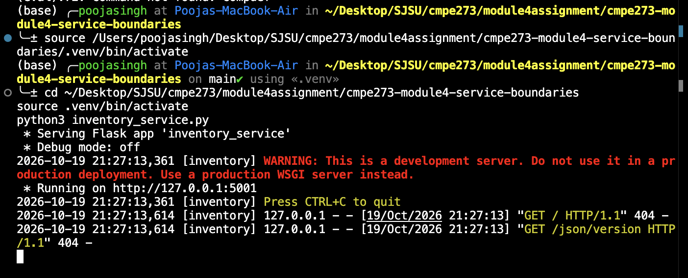
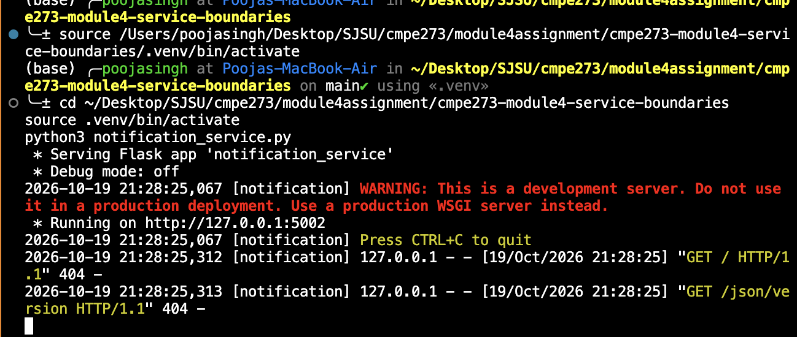
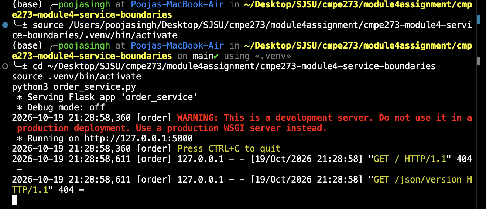
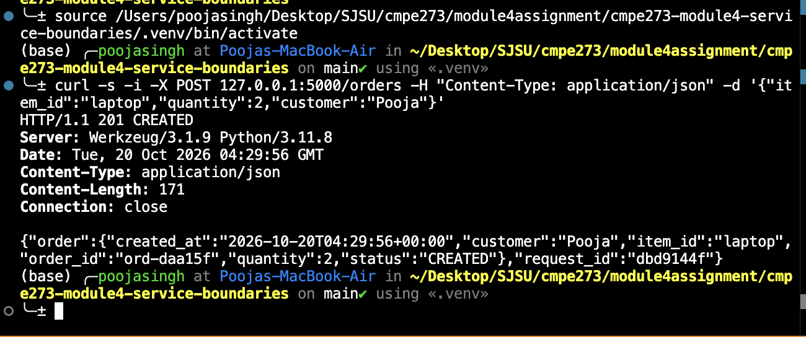
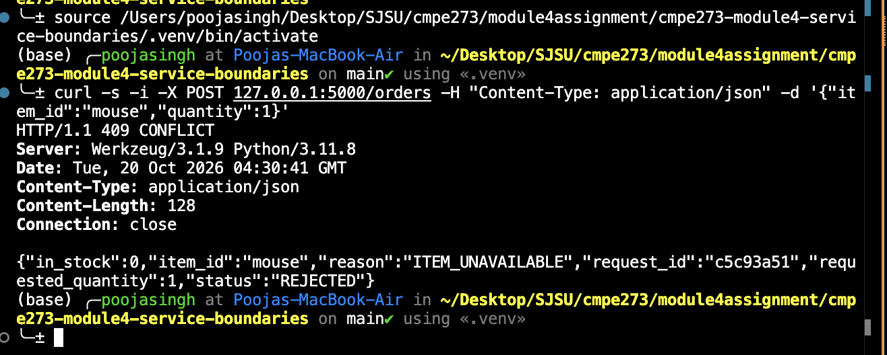
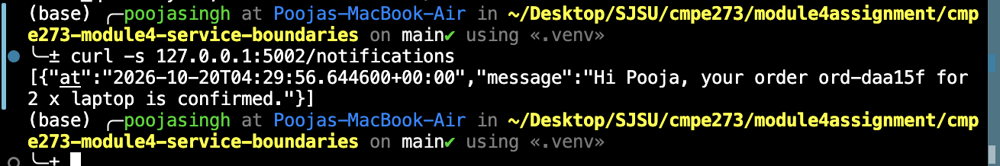
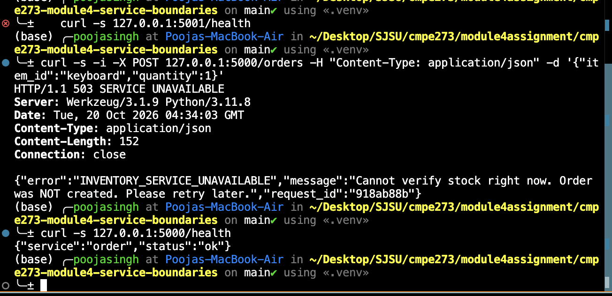
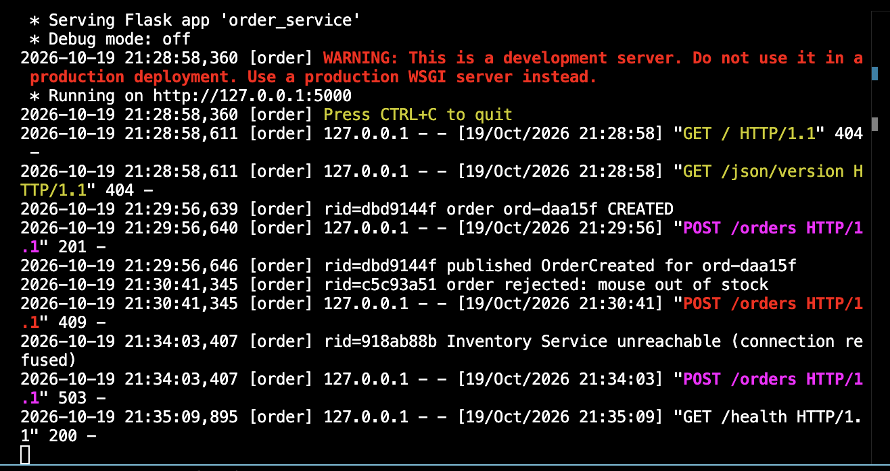

# CMPE 273 — Module 4: Architecture & Service Boundaries

A small online store split into three independent Python/Flask services:
**Order**, **Inventory**, and **Notification**. Order Service asks Inventory
Service whether an item is available before creating an order, and handles
Inventory being down without crashing.

---

## 1. How to install and run

**Requirements:** Python 3.10+

```bash
git clone <this-repo-url>
cd cmpe273-module4-service-boundaries
python3 -m venv .venv && source .venv/bin/activate
pip install -r requirements.txt
```

Start each service in its **own terminal** (each is an independent process):

```bash
# Terminal 1
python3 inventory_service.py        # http://127.0.0.1:5001

# Terminal 2
python3 notification_service.py     # http://127.0.0.1:5002

# Terminal 3
python3 order_service.py            # http://127.0.0.1:5000
```

Health checks:

```bash
curl localhost:5000/health
curl localhost:5001/health
curl localhost:5002/health
```

Sample inventory (in-memory, no database):

| item_id    | quantity |
|------------|----------|
| `laptop`   | 5        |
| `mouse`    | 0 (out of stock) |
| `keyboard` | 12       |

---

## 2. Architecture diagram

```mermaid
flowchart LR
    C([Client / curl])

    subgraph OS["Order Service :5000"]
        O[POST /orders<br/>GET /orders/:id]
        OD[(ORDERS<br/>in-memory)]
        O --- OD
    end

    subgraph IS["Inventory Service :5001"]
        I[GET /inventory/:item_id]
        ID[(STOCK<br/>in-memory)]
        I --- ID
    end

    subgraph NS["Notification Service :5002"]
        N[POST /events]
        ND[(SENT<br/>notifications)]
        N --- ND
    end

    C -- "1. COMMAND: create order<br/>(HTTP POST)" --> O
    O -- "2. QUERY: is item available?<br/>(HTTP GET, sync, 1s/2s timeout)" --> I
    I -- "3. available / unavailable" --> O
    O -. "4. EVENT: OrderCreated<br/>(HTTP POST, async fire-and-forget)" .-> N
    O -- "5. 201 / 409 / 503" --> C
```



ASCII version (in case Mermaid does not render):

```
                 (1) COMMAND: POST /orders
   Client  ──────────────────────────────►  Order Service :5000   [owns ORDERS]
     ▲                                          │        ┆
     │ (5) 201 Created / 409 Rejected /         │        ┆ (4) EVENT: OrderCreated
     │     503 Inventory Unavailable            │        ┆     async, fire-and-forget
     └──────────────────────────────────────────┘        ▼
                     (2) QUERY: GET /inventory/<item>   Notification Service :5002
                     (3) {available: true/false}        [owns SENT notifications]
                                │  ▲
                                ▼  │
                       Inventory Service :5001   [owns STOCK]
```

Solid arrows are **synchronous** (caller waits for the answer). The dotted
arrow is **asynchronous** (Order Service does not wait and does not care if it
fails).

---

## 3. Component responsibilities and data ownership

| Service | Responsibility | Data it owns | Does NOT do |
|---|---|---|---|
| **Order Service** | Accepts order requests, validates input, asks Inventory for availability, creates and stores orders, publishes `OrderCreated` | `ORDERS` — order id, item, quantity, customer, status, timestamp | Store or modify stock counts; send notifications itself |
| **Inventory Service** | Answers whether a given quantity of an item is in stock | `STOCK` — item id, name, quantity | Know anything about orders or customers |
| **Notification Service** | Reacts to `OrderCreated` events and "notifies" the customer (logged message) | `SENT` — record of notifications sent | Decide whether an order is valid; block order creation |

**Rule:** a service only reads/writes its *own* data. If Order Service needs
stock information, it must ask Inventory Service through its API — it never
touches `STOCK` directly. There is no shared database.

---

## 4. Why these service boundaries

- **Each boundary follows one business capability** that changes for its own
  reasons. Stock rules (warehouses, restocking) change independently of order
  rules (pricing, cancellation) and of notification channels (email, SMS, push).
- **One owner per piece of data.** Stock has a single source of truth
  (Inventory), so two services can never disagree about how many laptops exist.
- **Failure isolation.** Notification is a side effect, not part of the order
  decision. It is called asynchronously, so if Notification is down the order
  still succeeds. Inventory *is* required for the decision, so when it is down
  Order Service fails that one request cleanly (503) instead of guessing.
- **Independent deployment and scaling.** Inventory gets many read-heavy
  availability checks and could be scaled or cached separately from Order.

---

## 5. Command / Query / Event classification

| Interaction | Type | Why |
|---|---|---|
| **Check whether an item is available** | **Query** | Asks for information and changes nothing. Safe to repeat any number of times. Inventory answers `available: true/false`. (`GET /inventory/<item_id>`) |
| **Create an order** | **Command** | An instruction to change system state ("please do this"). It has a single target (Order Service) and can be **rejected** (409 out of stock, 503 dependency down). (`POST /orders`) |
| **Order was created** | **Event** | A fact in the past tense ("this already happened"). It cannot be rejected, the publisher does not know or care who listens, and it is sent fire-and-forget. (`POST /events` with `type: OrderCreated`) |

Memory hook: **Query = question, Command = request ("do this"), Event = news ("this happened").**

---

## 6. Example of a successful request

```bash
$ curl -s -X POST localhost:5000/orders \
    -H "Content-Type: application/json" -H "X-Request-ID: demo-001" \
    -d '{"item_id":"laptop","quantity":2,"customer":"Pooja"}' -w "\nHTTP %{http_code}\n"
{"order":{"created_at":"2026-10-17T20:06:16+00:00","customer":"Pooja","item_id":"laptop","order_id":"ord-5d728a","quantity":2,"status":"CREATED"},"request_id":"demo-001"}

HTTP 201
```

Notification Service received the event:

```bash
$ curl -s localhost:5002/notifications
[{"at":"2026-10-17T20:06:16.059311+00:00","message":"Hi Pooja, your order ord-5d728a for 2 x laptop is confirmed."}]
```

### Item unavailable (Inventory returns "unavailable")

```bash
$ curl -s -X POST localhost:5000/orders \
    -H "Content-Type: application/json" -H "X-Request-ID: demo-002" \
    -d '{"item_id":"mouse","quantity":1}' -w "\nHTTP %{http_code}\n"
{"in_stock":0,"item_id":"mouse","reason":"ITEM_UNAVAILABLE","request_id":"demo-002","requested_quantity":1,"status":"REJECTED"}

HTTP 409
```

### Service logs for the same requests (correlated by `X-Request-ID`)

```
[inventory]    rid=demo-001 item=laptop wanted=2 in_stock=5 -> available=True
[order]        rid=demo-001 order ord-5d728a CREATED
[notification] rid=demo-001 NOTIFY -> Hi Pooja, your order ord-5d728a for 2 x laptop is confirmed.
[order]        rid=demo-001 published OrderCreated for ord-5d728a
[inventory]    rid=demo-002 item=mouse wanted=1 in_stock=0 -> available=False
[order]        rid=demo-002 order rejected: mouse out of stock
```

---

## 7. Failure test — Inventory Service stopped

**Steps:** stop Inventory Service (Ctrl+C in Terminal 1, or `kill <pid>`), then
submit another order.

```bash
# Inventory Service stopped
$ curl -s -X POST localhost:5000/orders \
    -H "Content-Type: application/json" -H "X-Request-ID: demo-003" \
    -d '{"item_id":"keyboard","quantity":1}' -w "\nHTTP %{http_code}\n"
{"error":"INVENTORY_SERVICE_UNAVAILABLE","message":"Cannot verify stock right now. Order was NOT created. Please retry later.","request_id":"demo-003"}

HTTP 503

$ curl -s localhost:5000/health   # Is Order Service still alive?
{"service":"order","status":"ok"}
```

Order Service log:

```
[order] rid=demo-003 Inventory Service unreachable (connection refused)
[order] "POST /orders HTTP/1.1" 503 -
[order] "GET /health HTTP/1.1" 200 -
```

**Result:**

| Requirement | Result |
|---|---|
| Handle the dependency failure | `requests.ConnectionError` is caught; a timeout (1s connect / 2s read) also prevents hanging if Inventory is slow rather than dead |
| Return an appropriate error | **HTTP 503 Service Unavailable** with error code `INVENTORY_SERVICE_UNAVAILABLE` and a clear message that the order was not created. (A slow Inventory returns **504**; an Inventory 5xx returns **502**.) |
| Remain running instead of crashing | `/health` still returns `200 ok` right after the failure, and Order Service accepts orders again as soon as Inventory restarts |

Design choice: Order Service **fails closed** — it refuses the order rather
than assuming stock exists, because selling items we may not have is worse
than asking the customer to retry.

---
## Screenshots

### Services running as independent processes




### Successful order (201)


### Item unavailable (409)


### OrderCreated event received by Notification Service


### Failure test: Inventory stopped (503, Order Service still healthy)




## 8. Reflection

Clear service boundaries mean each service has one job and one reason to
change, so teams can modify, deploy, and scale Inventory without touching
Order or Notification. Giving each piece of data exactly one owner creates a
single source of truth; if two services wrote to the same stock table, they
could disagree or overwrite each other, and no one would be accountable for
correctness. Because services only interact through explicit APIs and events,
a failure stays contained: when Inventory went down, Order Service returned a
clean 503 and kept running instead of the whole system crashing. Without
these boundaries, a distributed system becomes a "distributed monolith" that
has all the network failure modes of microservices but none of the
independence.

---

## Project structure

```
.
├── order_service.py          # :5000  owns ORDERS
├── inventory_service.py      # :5001  owns STOCK
├── notification_service.py   # :5002  owns SENT
├── requirements.txt
└── README.md
```
